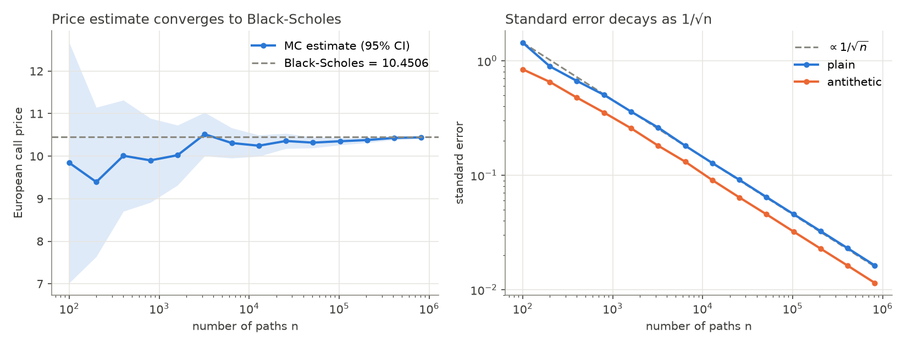

# Monte Carlo Option Pricer (C++17)

Monte Carlo pricer for European and arithmetic-average Asian options under
geometric Brownian motion, with standard errors, 95% confidence intervals and
antithetic variates. The European pricer is validated against the Black–Scholes
closed form; the Asian option, which has no closed-form price, shows where
Monte Carlo is actually needed.

## Features
- Black–Scholes closed-form benchmark (call and put)
- Monte Carlo pricing with standard error and 95% confidence interval
- Arithmetic-average Asian options (discretely monitored, path simulation)
- Antithetic variates variance reduction (standard error computed from independent pair averages)
- Numerically stable one-pass mean/variance (Welford's algorithm)
- Reproducible results via fixed RNG seed
- Unit tests (CTest)

## Model
Risk-neutral GBM with exact terminal sampling (no discretisation error):

```
S_T = S_0 · exp((r − σ²/2)·T + σ·√T·Z),   Z ~ N(0,1)
V_0 = e^(−rT) · E[payoff(S_T)]
```

The Monte Carlo estimate is the sample mean of discounted payoffs. Its standard
error is `s / √m`, where `s` is the sample standard deviation and `m` is the number
of independent samples. With antithetic variates each pair `(Z, −Z)` is averaged
into one sample, so `m = n / 2` for `n` payoff evaluations.

Asian options are priced on simulated paths with `steps` equally spaced monitoring
dates `t_k = k·T/steps`, using the exact GBM step
`S_{k+1} = S_k · exp((r − σ²/2)·Δt + σ·√Δt·Z_k)`, and payoff `max(A − K, 0)`
where `A` is the arithmetic average of `S_{t_1}, …, S_{t_steps}`.

## Build and run

Requires CMake ≥ 3.16 and a C++17 compiler.

Windows (MinGW / MSYS2):
```
cmake -S . -B build-release -G "MinGW Makefiles" -DCMAKE_BUILD_TYPE=Release
cmake --build build-release
.\build-release\mc_pricer.exe
```

Linux / macOS:
```
cmake -S . -B build-release -DCMAKE_BUILD_TYPE=Release
cmake --build build-release
./build-release/mc_pricer
```

Tests:
```
cd build-release
ctest --output-on-failure
```

Convergence plot (requires Python with matplotlib; `mc_pricer` writes
`convergence.csv` to the working directory):
```
python scripts/plot.py convergence.csv docs/convergence.png
```

## Results

Parameters: S0 = 100, K = 100, r = 5%, σ = 20%, T = 1 year, seed = 42.
Black–Scholes reference: call = 10.4506, put = 5.5735.

European call, `n` = number of payoff evaluations:

|         n | MC plain |     SE | MC antithetic | SE antithetic |
|----------:|---------:|-------:|--------------:|--------------:|
|     1,000 |  10.7783 | 0.4913 |       10.6350 |        0.3405 |
|    10,000 |  10.6298 | 0.1482 |       10.5167 |        0.1041 |
|   100,000 |  10.5120 | 0.0469 |       10.4520 |        0.0328 |
| 1,000,000 |  10.4723 | 0.0147 |       10.4499 |        0.0104 |

- Standard error falls by ≈ √10 per tenfold increase in `n`, as expected from the 1/√n rate.
- Antithetic variates reduce the standard error by ~29% at equal payoff evaluations
  (~50% lower variance, i.e. the same accuracy with about half the paths).
- All estimates lie within 2 standard errors of the Black–Scholes price.
- Rows share the same seed, so smaller runs are prefixes of larger ones and their errors are correlated.



Arithmetic-average Asian call, 252 monitoring dates (daily), 100,000 paths:

|            | Price  |     SE | 95% CI           |
|------------|-------:|-------:|------------------|
| plain      | 5.7525 | 0.0252 | [5.7030, 5.8020] |
| antithetic | 5.7689 | 0.0175 | [5.7345, 5.8032] |

The Asian call is cheaper than the European call (10.4506) because averaging
reduces the effective volatility of the underlying.

Throughput: ~17–19 M paths/s, single-threaded (10^7 paths in ~0.55 s; GCC 13.2, -O3, Intel Core i5-12450H).

## Validation
The test suite checks:
- Black–Scholes call and put against known reference values
- put–call parity: C − P = S0 − K·e^(−rT)
- Monte Carlo call and put prices within 3 standard errors of Black–Scholes (plain and antithetic)
- antithetic variates give a lower standard error than plain sampling at equal `n`
- standard error halves when `n` quadruples
- Asian call is cheaper than the European call
- Asian put–call parity: C − P = e^(−rT)·(E[A] − K), with E[A] = (S0/steps)·Σ e^(r·t_k)
- antithetic variates reduce the standard error for the Asian call
- invalid input (fewer than 2 samples, zero monitoring steps) is rejected

## Project structure
```
include/   bs.hpp, mc.hpp     public interfaces
src/       bs.cpp, mc.cpp     Black–Scholes and Monte Carlo implementations
           main.cpp           comparison tables, convergence data, throughput benchmark
test/      test.cpp           unit tests
scripts/   plot.py            convergence plot
docs/      convergence.png    figure used in this README
```

## Limitations
- Inputs must satisfy T > 0 and σ > 0.
- `std::normal_distribution` is implementation-defined, so exact numbers may differ
  slightly between compilers; tests therefore compare within statistical tolerance.

## Future work
- Greeks (pathwise and likelihood-ratio estimators)
- Control variates
- Multithreading (OpenMP with independent per-thread RNG streams)